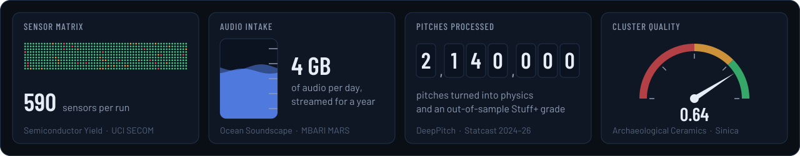
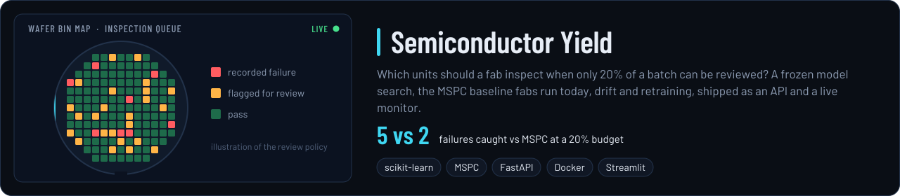
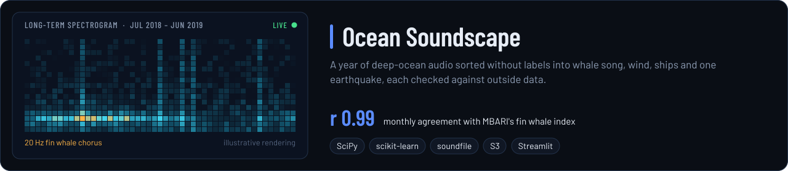
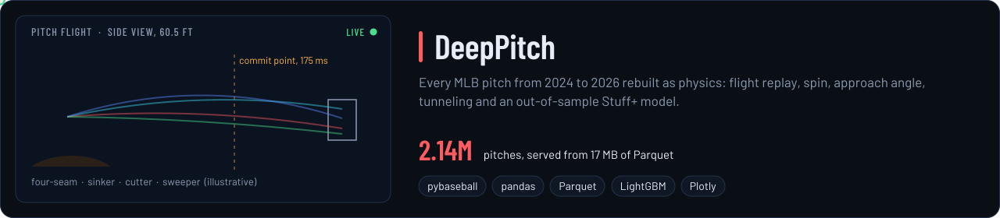
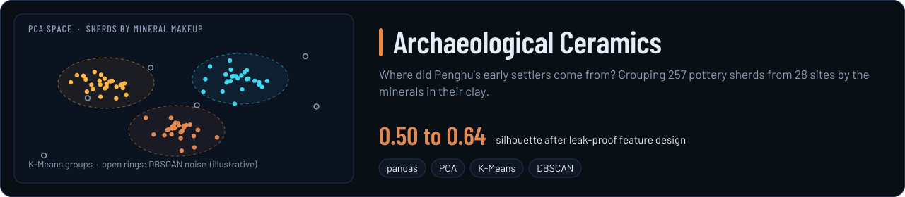
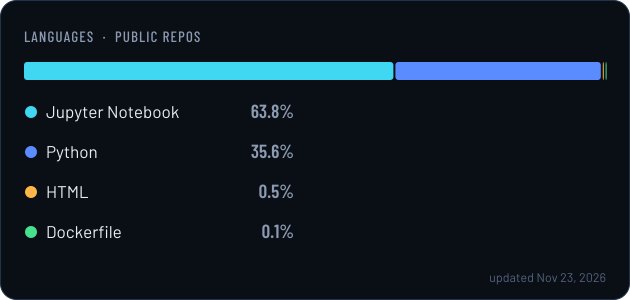
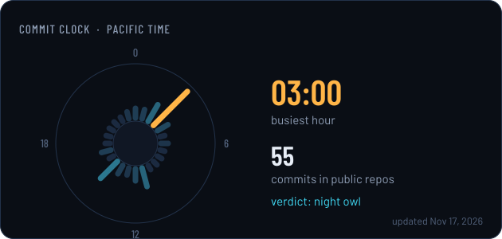

  &nbsp;
  &nbsp;
  &nbsp;
  

I'm Paul, an M.S. Data Science student at UC San Diego. I like data that arrives large and messy, from sensors, archives and streams, and results that still hold when checked against the world outside the model. That points me toward **AI data solutions, smart manufacturing and big data processing**. Below are the lines I've built so far; open any of them for screenshots and details. My work history lives on my [portfolio](https://paul-lai.vercel.app) and [resume](https://paul-lai.vercel.app/assets/Paul_Lai_Resume.pdf).

## Production lines

<b>Open the line:</b> Semiconductor Yield · results, method, repo

 

- **Data:** UCI SECOM, 1,567 production runs × 590 anonymized sensors, 104 failures (6.6%). Predicting "pass" everywhere scores 93% accuracy and catches nothing, so every method is judged by failures caught per review.
- **Search:** 50 fixed configurations (forests, boosting, SVMs, linear, nearest neighbors, novelty detectors) over three expanding forward blocks, 150 fits, plus one predeclared rank blend.
- **Discipline:** the protocol and source hashes were saved before the search, and the recipe was frozen before the latest 20% of runs were scored.
- **Result:** 5 of 17 later failures with 62 reviews, the same as the previous recipe. Reported as it came out, not as the best of many tries.

[Repository](https://github.com/Paul-Lai0111/semiconductor-yield-anomaly-detection) · [Executed notebook](https://github.com/Paul-Lai0111/semiconductor-yield-anomaly-detection/blob/main/manufacturing_notebook.ipynb) · [Full results](https://github.com/Paul-Lai0111/semiconductor-yield-anomaly-detection/blob/main/manufacturing_results/RESULTS.md)

<b>Open the line:</b> Ocean Soundscape · findings, live dashboard, repo

 

- **Pipeline:** 8 commands stream minutes from MBARI's 4 GB-per-day public archive, extract 16 calibrated acoustic features and cluster them.
- **Weather first:** 1–8 kHz noise tracks NOAA buoy wind (r = 0.86 for the year); relative features cut the clusters' wind dependence from η² 0.49 to 0.020 and lift silhouette from 0.27 to 0.51.
- **Outside check:** agrees with MBARI's published call indices month by month (r = 0.99 fin, 0.91 blue); the comparison exposed a flaw whose fix raised per-minute agreement from 0.81 to 0.93.
- **Surprise:** the loudest minute of the first week is an M3.3 earthquake 78 km away, found as an outlier.

[Live dashboard](https://ocean-soundscape-ml-paullai.streamlit.app) · [Repository](https://github.com/Paul-Lai0111/ocean-soundscape-ml) · [Full report](https://github.com/Paul-Lai0111/ocean-soundscape-ml/blob/main/docs/analysis.md)

<b>Open the line:</b> DeepPitch · screenshots, findings, live app

 

 

- **Pipeline:** 2.14M Statcast pitches (2024–26) fetched in 6-day chunks, rebuilt by a unit-tested physics engine and served from about 17 MB of Parquet.
- **Model:** LightGBM Stuff+ scored leave-one-season-out, so every grade is out-of-sample; it correlates 0.45 with next season's run value, against 0.19 for this season's results.
- **Finding:** across 1,082 pitcher-season four-seamers, vertical approach angle relates to whiffs (r = +0.47) while "rise" barely does (r = −0.02).
- **App:** eight pages in English and Traditional Chinese, from flight replay to a physics lab.

[Live app](https://paul-2024mlb-deeppitch-analytics.streamlit.app/) · [Repository](https://github.com/Paul-Lai0111/MLB_DeepPitch_Dashboard)

<b>Open the line:</b> Archaeological Ceramics · method, figures, repo

 

- **Data:** 257 sherds from 28 excavation sites in Penghu and Nanke, 11 compositional variables (the data belongs to the institutes and stays private).
- **Leak-proofing:** the site code handed the model the answer, so it was removed along with a texture-only field, 13 → 11 variables.
- **Result:** K-Means beat DBSCAN on every dataset; silhouette rose from 0.50 to 0.64 on Nanke, while DBSCAN flagged isolated sherds for re-examination.

[Repository](https://github.com/Paul-Lai0111/sinica-ceramic-clustering) · [Case study](https://paul-lai.vercel.app/projects/ceramic-clustering/)

<b>Open the line:</b> streamlit-wake · how it works

 

- A plain ping can't wake a sleeping Streamlit app, because the sleep page loads fine; only pressing the button in a browser does.
- So a scheduled workflow opens each app in headless Chromium with Playwright, presses the button if it's there and waits for the app to render. If an app doesn't come back within 4 minutes, the run fails and GitHub emails you.
- Use it as a template repository or as a one-step composite action. MIT licensed. It keeps the two live demos above awake.

[Repository](https://github.com/Paul-Lai0111/streamlit-wake)

## Telemetry

 

Redrawn every day by a GitHub Action from the public GitHub API ([build_stats.py](scripts/build_stats.py)).

## Toolbox

| Equipment | What it does on these lines | Lines |
|---|---|---|
| Python, pandas, NumPy | ingest, cleaning, time ordering, feature tables | all |
| scikit-learn | preprocessing, PCA, clustering, model search, validation | Yield · Ocean · Ceramics |
| XGBoost, LightGBM | gradient boosting for failure ranking and Stuff+ | Yield · DeepPitch |
| SciPy, soundfile | calibrated spectra and acoustic features from raw audio | Ocean |
| Parquet (pyarrow), AWS S3 | columnar storage, streaming from public archives | DeepPitch · Ocean |
| Streamlit, Plotly, matplotlib | live dashboards and figures | Ocean · DeepPitch · Ceramics |
| pytest, GitHub Actions, Playwright | tests, CI, scheduled browser automation | Yield · DeepPitch · Wake |

All artwork is drawn in code (<a href="scripts">scripts/</a>), lettered in Barlow under the SIL Open Font License.

