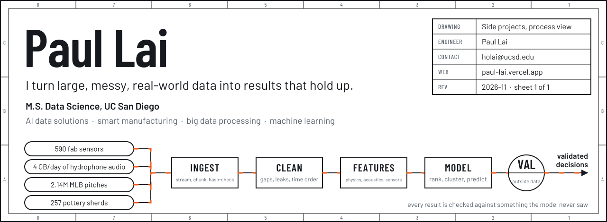
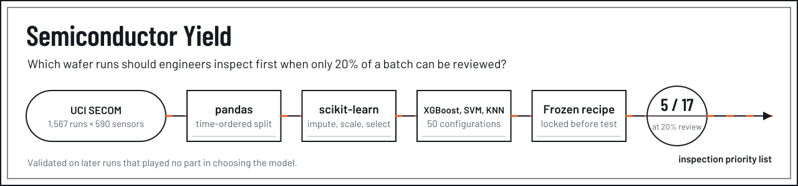
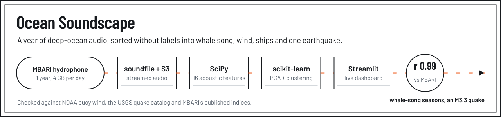
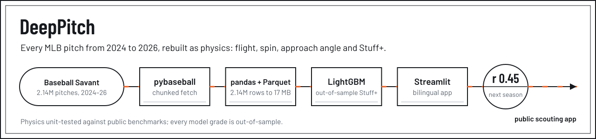
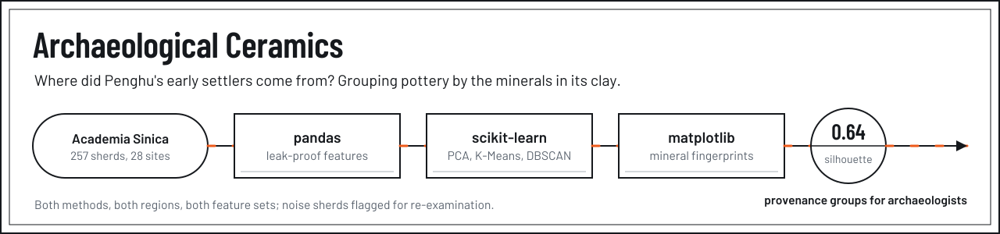
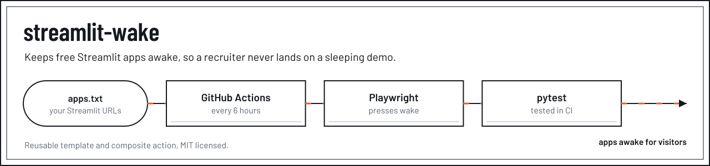

  <a href="https://paul-lai.vercel.app/assets/Paul_Lai_Resume.pdf"><b>Resume (PDF)</b></a> &nbsp;·&nbsp;
  <a href="https://paul-lai.vercel.app">Portfolio</a> &nbsp;·&nbsp;
  <a href="https://www.linkedin.com/in/paullai0111/">LinkedIn</a> &nbsp;·&nbsp;
  <a href="mailto:holai@ucsd.edu">holai@ucsd.edu</a>

I'm Paul, an M.S. Data Science student at UC San Diego. I like data that arrives large and messy, from sensors, archives and streams, and results that still hold when checked against the world outside the model. That points me toward AI data solutions, smart manufacturing and big data processing.

These are my side projects, drawn as the process lines they are. My work history and the longer story are on my [portfolio](https://paul-lai.vercel.app) and [resume](https://paul-lai.vercel.app/assets/Paul_Lai_Resume.pdf).

## Process lines

**[semiconductor-yield-anomaly-detection](https://github.com/Paul-Lai0111/semiconductor-yield-anomaly-detection)** · Failure detection on fab sensor data under a fixed inspection budget, with forward-in-time validation, a recipe frozen before assessment, tests and CI. The result is reported as it came out, not as the best of many tries.

**[ocean-soundscape-ml](https://github.com/Paul-Lai0111/ocean-soundscape-ml)** · Unsupervised learning on a 4 GB-a-day public audio archive, with every pattern checked against independent data. [Live dashboard →](https://ocean-soundscape-ml-paullai.streamlit.app)

**[MLB_DeepPitch_Dashboard](https://github.com/Paul-Lai0111/MLB_DeepPitch_Dashboard)** · A 2.14M-row pipeline compressed into 17 MB of serving tables, a unit-tested physics engine and an out-of-sample model, behind a bilingual app. [Live app →](https://paul-2024mlb-deeppitch-analytics.streamlit.app/)

**[sinica-ceramic-clustering](https://github.com/Paul-Lai0111/sinica-ceramic-clustering)** · Leak-proof feature design and two clustering families on compositional data, refactored from a research internship into a reproducible pipeline.

**[streamlit-wake](https://github.com/Paul-Lai0111/streamlit-wake)** · The small tool that keeps the two live demos above awake. Use it as a template or as a one-step action.

## Equipment list

| Equipment | What it does on these lines | Lines |
|---|---|---|
| Python, pandas, NumPy | ingest, cleaning, time ordering, feature tables | all |
| scikit-learn | preprocessing, PCA, clustering, model search, validation | Yield · Ocean · Ceramics |
| XGBoost, LightGBM | gradient boosting for failure ranking and Stuff+ | Yield · DeepPitch |
| SciPy, soundfile | calibrated spectra and acoustic features from raw audio | Ocean |
| Parquet (pyarrow), AWS S3 | columnar storage and streaming from public archives | DeepPitch · Ocean |
| Streamlit, Plotly, matplotlib | live dashboards and figures | Ocean · DeepPitch · Ceramics |
| pytest, GitHub Actions, Playwright | tests, CI and scheduled browser automation | Yield · DeepPitch · Wake |

Drawings are generated by <a href="scripts/build_assets.py">scripts/build_assets.py</a>, lettered in Barlow (SIL Open Font License).

